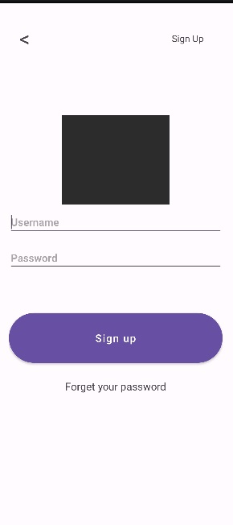
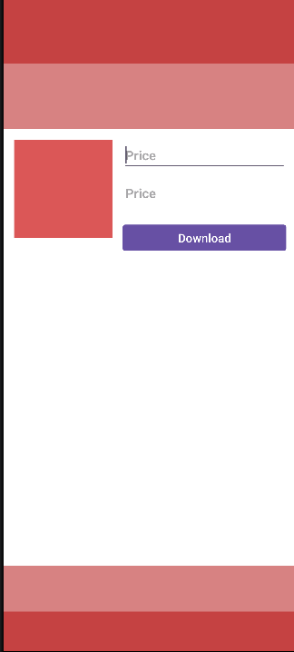

# 📱 Aplicação Mobile - E-Commerce / Loja Digital

Este projeto é uma aplicação Android nativa desenvolvida como parte de uma atividade académica. O objetivo da aplicação é simular a experiência de navegação, visualização de produtos/cards e autenticação de utilizadores numa loja digital.

---

## 📌 Funcionalidades

* **Autenticação de Utilizadores:**
  * Ecrã de Login / Registo com suporte para campos de texto seguros (`TextInputLayout`).
  * Alternância de visibilidade de palavra-passe e validação de campos.
  * Opção de recuperação de palavra-passe.

* **Exibição de Produtos (Cards):**
  * Layout estruturado para apresentação de itens/produtos com imagens, preços e descrições.
  * Botões de ação rápida (ex: Download / Comprar).

---

## 🛠️ Tecnologias e Ferramentas

* **Linguagem:** Kotlin
* **Plataforma:** Android (Android Studio)
* **UI & Layouts:** XML (LinearLayout, RelativeLayout, Material Components)
* **Design System:** Google Material Design 3
* **Build System:** Gradle (Kotlin DSL)

---
<h2 align="center">📱 Telas do Aplicativo</h2>

<div align="center">
  <table>
    <tr>
      <td align="center">
        <b>Tela de Autenticação (Login)</b><br/><br/>
        
      </td>
      <td align="center">
        <b>Layout dos Cards (Home)</b><br/><br/>
        
      </td>
    </tr>
  </table>
</div>


## 📂 Estrutura do Repositório

```text
.
├── app/
│   ├── src/
│   │   └── main/
│   │       ├── java/          # Código-fonte da aplicação (Activities, Adapters)
│   │       └── res/           # Recursos visuais (Layouts XML, Drawables, Values)
│   └── build.gradle.kts
├── gradle/
├── build.gradle.kts
└── settings.gradle.kts


